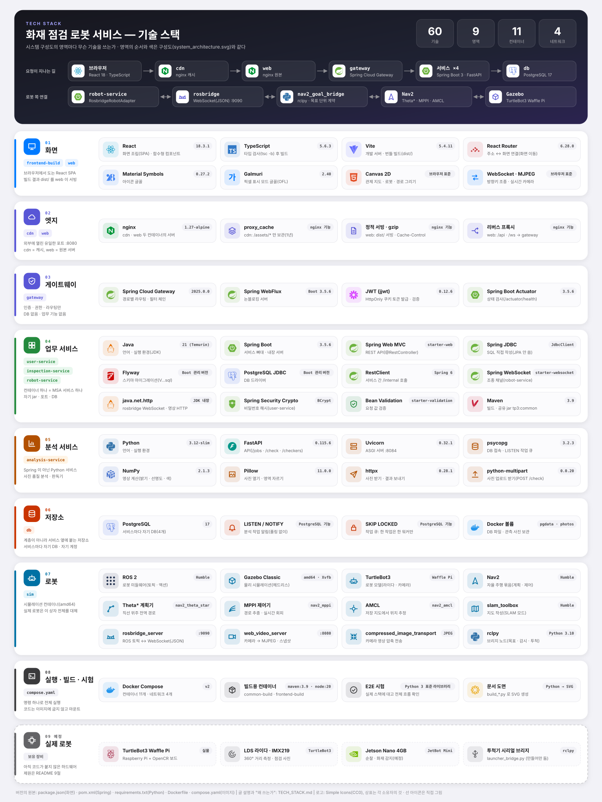

# 기술 스택

> 이 파일은 `build_tech_stack.py` 가 만든다. 직접 고치지 말고 스크립트의 `STACK` 을 고친 뒤 다시 생성한다
> (`python3 docs/architecture/build_tech_stack.py`). 그림은 [tech_stack.svg](tech_stack.svg).

[시스템 구성도](system_architecture.svg)의 영역마다 **무슨 기술을, 어디에, 왜** 쓰는지 적는다.
영역 순서는 구성도에서 요청이 지나는 순서와 같다.

**핵심 스택**(그림의 붉은 상자, 표의 🟥)은 구성도의 구조를 이루는 상위 기술 15개다. 나머지는 그 아래에서 쓰는 라이브러리 · 기능이다.

## 한눈에

요청이 지나는 길: `브라우저`(React 18 · TypeScript) → `cdn`(nginx 캐시) → `web`(nginx 원본) → `gateway`(Spring Cloud Gateway) → `서비스 ×4`(Spring Boot 3 · FastAPI) → `db`(PostgreSQL 17)

로봇 쪽 연결: `robot-service`(RosbridgeRobotAdapter) ⇄ `rosbridge`(WebSocket(JSON) :9090) ⇄ `nav2_goal_bridge`(rclpy · 목표 단위 계약) ⇄ `Nav2`(Theta* · MPPI · AMCL) ⇄ `Gazebo`(TurtleBot3 Waffle Pi)

| 영역 | 컨테이너 | 핵심 스택 |
| --- | --- | --- |
| [화면](#화면) | frontend-build · web | **React** 18.3.1 · **TypeScript** 5.6.3 · **Vite** 5.4.11 |
| [엣지](#엣지) | cdn · web | **nginx** 1.27-alpine |
| [게이트웨이](#게이트웨이) | gateway | **Spring Cloud Gateway** 2025.0.0 |
| [업무 서비스](#업무-서비스) | user-service · inspection-service · robot-service | **Java** 21 (Temurin) · **Spring Boot** 3.5.6 |
| [분석 서비스](#분석-서비스) | analysis-service | **Python** 3.12-slim · **FastAPI** 0.115.6 |
| [저장소](#저장소) | db | **PostgreSQL** 17 |
| [로봇](#로봇) | sim | **ROS 2** · **Gazebo Classic** · **Nav2** · **rosbridge_server** |
| [실행 · 빌드 · 시험](#실행--빌드--시험) | compose.yaml | **Docker Compose** |
| [실제 로봇](#실제-로봇) | 보유 장비 | — |

## 화면

브라우저가 받아 실행하는 React SPA. `frontend-build` 컨테이너가 `dist/` 로 빌드하고 `web`(nginx)이 그대로 내보낸다.

- 컨테이너: frontend-build · web
- 버전의 원본: `web/nginx/frontend/package.json`

| 기술 | 버전 | 하는 일 | 왜 쓰는가 |
| --- | --- | --- | --- |
| 🟥 **React** | 18.3.1 | 화면 조립(SPA) · 함수형 컴포넌트 | 화면을 부품(컴포넌트)으로 나누고, 상태가 바뀐 부분만 다시 그린다. |
| 🟥 **TypeScript** | 5.6.3 | 타입 검사(tsc -b) 후 빌드 | API 응답 모양을 타입으로 적어 두어, 틀린 사용을 빌드 때 잡는다. |
| 🟥 **Vite** | 5.4.11 | 개발 서버 · 번들 빌드(dist/) | 빌드가 빠르고, 결과 파일 이름에 해시를 붙여 `/assets/*` 를 오래 캐시할 수 있게 한다. |
| **React Router** | 6.28.0 | 주소 ↔ 화면 연결(화면 이동) | 새로 고침 없이 화면을 바꾼다. 어느 주소로 들어와도 `web` 이 `index.html` 을 돌려준다. |
| **Material Symbols** | 0.27.2 | 아이콘 글꼴 | SF Symbols 는 라이선스상 웹에 넣을 수 없어 대신 쓴다(`Icon.tsx` 가 이름을 매핑). |
| **Galmuri** | 2.40 | 픽셀 표시 모드 글꼴(OFL) | 픽셀 모드 스킨(`pixel.css`)에서만 쓰는 한글 픽셀 글꼴. |
| **Canvas 2D** | 브라우저 표준 | 관제 지도 · 로봇 · 경로 그리기 | 지도 라이브러리 없이 직접 그린다(`mapGeo.ts`). 0.2초 폴링 + 위치 보간. |
| **WebSocket · MJPEG** | 브라우저 표준 | 방향키 조종 · 실시간 카메라 | 조종은 양방향 연결이 필요하고, 영상은 `` 하나로 받는 MJPEG 로 충분하다. |

## 엣지

브라우저가 처음 만나는 두 컨테이너. 둘 다 nginx 이고 업무 로직은 없다.

- 컨테이너: cdn · web
- 버전의 원본: `compose.yaml · web/nginx/{cdn,web}/default.conf`

| 기술 | 버전 | 하는 일 | 왜 쓰는가 |
| --- | --- | --- | --- |
| 🟥 **nginx** | 1.27-alpine | cdn · web 두 컨테이너의 서버 | 설정 파일만으로 캐시 · 정적 서빙 · 프록시를 모두 한다. |
| **proxy_cache** | nginx 기능 | cdn: /assets/* 만 보관(1년) | CDN 엣지 역할. `index.html` · `/api` · `/ws` 는 보관하지 않고 통과시킨다. 실제 배포에서는 외부 CDN 자리. |
| **정적 서빙 · gzip** | nginx 기능 | web: dist/ 서빙 · Cache-Control | 캐시 기간은 원본 서버(`web`)가 헤더로 지시하고 `cdn` 이 따른다. |
| **리버스 프록시** | nginx 기능 | web: /api · /ws → gateway | WebSocket 은 Upgrade 헤더를 넘기고, 영상 스트림은 버퍼링을 끈다. |

## 게이트웨이

모든 `/api` · `/ws` 요청이 지나는 한 곳. 여기서 인증 · 역할 확인 · 감사 기록을 하고 서비스로 넘긴다.

- 컨테이너: gateway
- 버전의 원본: `web/spring/gateway/pom.xml · web/spring/common/pom.xml`

| 기술 | 버전 | 하는 일 | 왜 쓰는가 |
| --- | --- | --- | --- |
| 🟥 **Spring Cloud Gateway** | 2025.0.0 | 경로별 라우팅 · 필터 체인 | 인증 · 권한을 서비스마다 다시 만들지 않고 한 곳에 둔다(규칙은 `application.yml`). |
| **Spring WebFlux** | Boot 3.5.6 | 논블로킹 서버 | 게이트웨이는 받아서 넘기는 일만 하므로 연결을 붙잡지 않는 방식이 맞다(영상 · WebSocket 도 지난다). |
| **JWT (jjwt)** | 0.12.6 | HttpOnly 쿠키 토큰 발급 · 검증 | 토큰을 스크립트가 읽지 못하는 쿠키에 둔다. 발급 · 검증 코드는 공유 jar `tp3:common` 의 `JwtCodec`. |
| **Spring Boot Actuator** | 3.5.6 | 상태 검사(/actuator/health) | compose 가 컨테이너 상태를 확인하는 데 쓴다(Spring 서비스 공통). |

## 업무 서비스

Spring Boot 서비스 셋(`user-service` · `inspection-service` · `robot-service`). 같은 뼈대를 쓰고 서비스마다 자기 DB 를 가진다.

- 컨테이너: user-service · inspection-service · robot-service
- 버전의 원본: `web/spring/*/pom.xml · web/spring/*/Dockerfile`

| 기술 | 버전 | 하는 일 | 왜 쓰는가 |
| --- | --- | --- | --- |
| 🟥 **Java** | 21 (Temurin) | 언어 · 실행 환경(JDK) | 장기 지원(LTS) 판. 레코드 · 패턴 매칭으로 코드가 짧아진다. |
| 🟥 **Spring Boot** | 3.5.6 | 서비스 뼈대 · 내장 서버 | 설정 없이 jar 하나로 실행된다. |
| **Spring Web MVC** | starter-web | REST API(@RestController) | 요청 하나에 스레드 하나인 단순한 방식. 업무 서비스에는 이것으로 충분하다. |
| **Spring JDBC** | JdbcClient | SQL 직접 작성(JPA 안 씀) | 표가 단순하고 `SKIP LOCKED` 같은 SQL 을 그대로 써야 해서 ORM 을 두지 않았다. |
| **Flyway** | Boot 관리 버전 | 스키마 마이그레이션(V…sql) | 서비스가 시작할 때 자기 DB 스키마를 스스로 맞춘다. |
| **PostgreSQL JDBC** | Boot 관리 버전 | DB 드라이버 | PostgreSQL 접속. |
| **RestClient** | Spring 6 | 서비스 간 /internal 호출 | 서비스끼리는 내부 HTTP 로만 부른다(상대 주소는 compose 서비스 이름). |
| **Spring WebSocket** | starter-websocket | 조종 채널(robot-service) | 방향키 조종 명령을 끊김 없이 받는다(`TeleopHandler`). |
| **java.net.http** | JDK 내장 | rosbridge WebSocket · 영상 HTTP | 로봇 연결(`RosbridgeRobotAdapter`)에 외부 라이브러리를 더하지 않는다. |
| **Spring Security Crypto** | BCrypt | 비밀번호 해시(user-service) | Spring Security 전체가 아니라 해시 기능만 쓴다(인증은 게이트웨이가 한다). |
| **Bean Validation** | starter-validation | 요청 값 검증 | 잘못된 입력을 컨트롤러에 들어오기 전에 막는다. |
| **Maven** | 3.9 | 빌드 · 공유 jar tp3:common | 서비스는 시작할 때 `mvn package` 로 빌드한다. 공유 코드는 `common-build` 가 m2 볼륨에 설치. |

## 분석 서비스

관측 사진을 분석하고 규칙대로 판독하는 Python 서비스. 영상 계산 때문에 Spring 이 아닌 Python 으로 따로 두었다.

- 컨테이너: analysis-service
- 버전의 원본: `web/python/analysis-service/requirements.txt · Dockerfile`

| 기술 | 버전 | 하는 일 | 왜 쓰는가 |
| --- | --- | --- | --- |
| 🟥 **Python** | 3.12-slim | 언어 · 실행 환경 | 영상 계산 라이브러리(numpy · Pillow)를 바로 쓴다. |
| 🟥 **FastAPI** | 0.115.6 | API(/jobs · /check · /checkers) | 요청 · 응답 모양을 타입으로 적으면 검증까지 해 준다. |
| **Uvicorn** | 0.32.1 | ASGI 서버 :8084 | FastAPI 를 실행하는 서버. |
| **psycopg** | 3.2.3 | DB 접속 · LISTEN 작업 큐 | PostgreSQL 의 LISTEN/NOTIFY 를 그대로 쓸 수 있다. |
| **NumPy** | 2.1.3 | 영상 계산(밝기 · 선명도 · 색) | 판독기(OBJECT · GAUGE · LAMP · THERMAL)의 계산. 학습 모델은 아직 없다. |
| **Pillow** | 11.0.0 | 사진 열기 · 영역 자르기 | OpenCV 없이도 필요한 처리는 된다(이미지가 가볍다). |
| **httpx** | 0.28.1 | 사진 받기 · 결과 보내기 | inspection-service 의 `/internal` 을 부른다. |
| **python-multipart** | 0.0.20 | 사진 업로드 받기(POST /check) | FastAPI 가 파일 업로드를 받을 때 필요하다. |

## 저장소

PostgreSQL 컨테이너 하나에 서비스별 DB(`userdb` · `inspectiondb` · `robotdb` · `analysisdb`)를 둔다. 서비스는 자기 DB 만 본다.

- 컨테이너: db
- 버전의 원본: `compose.yaml · web/postgres/`

| 기술 | 버전 | 하는 일 | 왜 쓰는가 |
| --- | --- | --- | --- |
| 🟥 **PostgreSQL** | 17 | 서비스마다 자기 DB(4개) | 컨테이너는 하나지만 DB 와 계정을 나눠 MSA 의 "서비스별 저장소"를 지킨다. |
| **LISTEN / NOTIFY** | PostgreSQL 기능 | 분석 작업 알림(폴링 없이) | 메시지 브로커(Kafka · RabbitMQ)를 따로 띄우지 않고 DB 로 작업을 알린다. |
| **SKIP LOCKED** | PostgreSQL 기능 | 작업 큐: 한 작업은 한 워커만 | `FOR UPDATE SKIP LOCKED` 로 집으면 워커가 여럿이어도 같은 작업을 두 번 집지 않는다. |
| **Docker 볼륨** | pgdata · photos | DB 파일 · 관측 사진 보관 | 컨테이너를 다시 만들어도 데이터가 남는다. |

## 로봇

ROS 2 로봇 시스템. 지금은 Gazebo 시뮬레이션이고, 실제 로봇도 같은 노드 · 토픽을 쓴다. 웹과는 rosbridge 로만 만난다.

- 컨테이너: sim
- 버전의 원본: `ros/sim/Dockerfile · ros/sim/src/config/nav2_params.yaml`

| 기술 | 버전 | 하는 일 | 왜 쓰는가 |
| --- | --- | --- | --- |
| 🟥 **ROS 2** | Humble | 로봇 미들웨어(토픽 · 액션) | TurtleBot3 와 Nav2 가 공식 지원하는 장기 지원 판. |
| 🟥 **Gazebo Classic** | amd64 · Xvfb | 물리 시뮬레이션(헤드리스) | 실물 없이 주행 · 센서를 시험한다. amd64 패키지만 있어 Apple Silicon 에서는 에뮬레이션으로 돈다. |
| **TurtleBot3** | Waffle Pi | 로봇 모델(라이다 · 카메라) | 보유한 실물과 같은 모델. |
| 🟥 **Nav2** | Humble | 자율 주행 묶음(계획 · 제어) | 목표 좌표를 주면 경로를 짜고 따라간다(NavigateToPose 액션). |
| **Theta* 계획기** | nav2_theta_star | 직선 위주 전역 경로 | 격자를 따라 꺾이는 경로 대신 보이는 점끼리 곧게 잇는다. |
| **MPPI 제어기** | nav2_mppi | 경로 추종 · 실시간 회피 | 후보 궤적을 많이 굴려 보고 가장 나은 속도를 고른다. |
| **AMCL** | nav2_amcl | 저장 지도에서 위치 추정 | 라이다 스캔을 저장 지도에 맞춰 로봇 위치를 잡는다(nav 모드). |
| **slam_toolbox** | Humble | 지도 작성(SLAM 모드) | 운영 지도 `ros/maps/site.*` 를 만든다. |
| 🟥 **rosbridge_server** | :9090 | ROS 토픽 ↔ WebSocket(JSON) | Java 서비스가 ROS 를 설치하지 않고도 토픽을 주고받는다. |
| **web_video_server** | :8080 | 카메라 → MJPEG · 스냅샷 | 카메라 토픽을 HTTP 영상으로 바꿔 브라우저까지 중계할 수 있게 한다. |
| **compressed_image_transport** | JPEG | 카메라 영상 압축 전송 | 실제 로봇에서 Wi-Fi 로 원본 영상을 보내지 않기 위해서다. |
| **rclpy** | Python 3.10 | 브리지 노드(목표 · 감시 · 투척) | `nav2_goal_bridge` · `cmd_vel_watchdog` · `mock_launcher` 를 Python 노드로 짠다. |

## 실행 · 빌드 · 시험

전체를 한 번에 띄우고 확인하는 도구.

- 컨테이너: compose.yaml
- 버전의 원본: `compose.yaml · scripts/ · docs/`

| 기술 | 버전 | 하는 일 | 왜 쓰는가 |
| --- | --- | --- | --- |
| 🟥 **Docker Compose** | v2 | 컨테이너 11개 · 네트워크 4개 | 실행 9 + 빌드용 2. 네트워크(front · edge · backend · robot)로 서로 닿는 범위를 나눈다. |
| **빌드용 컨테이너** | maven:3.9 · node:20 | common-build · frontend-build | 호스트에 JDK · Node 를 설치하지 않아도 된다(`docs/guide/BUILD_CONTAINERS.md`). |
| **E2E 시험** | Python 3 표준 라이브러리 | 실제 스택에 대고 전체 흐름 확인 | 단위 테스트 대신 떠 있는 스택에 요청을 보내 본다(`scripts/e2e_test.py` · `e2e_scenarios.py`). |
| **문서 도면** | Python → SVG | build_*.py 로 SVG 생성 | 도면을 손으로 고치지 않고 스크립트에서 다시 만든다. |

## 실제 로봇

보유한 하드웨어. 지금은 시뮬레이션으로만 돌고, 실물 연동은 `docs/plan/SCHEDULE.md` 의 일정대로 한다.

- 컨테이너: 보유 장비
- 버전의 원본: `README.md 9절`

| 기술 | 버전 | 하는 일 | 왜 쓰는가 |
| --- | --- | --- | --- |
| **TurtleBot3 Waffle Pi** | 실물 | Raspberry Pi + OpenCR 보드 | sim 컨테이너 자리를 대신한다(같은 노드 · 토픽, 목표 브리지도 같은 코드). |
| **LDS 라이다 · IMX219** | TurtleBot3 | 360° 거리 측정 · 점검 사진 | 주행(Nav2)과 관측 사진의 입력. |
| **Jetson Nano 4GB** | JetBot Mini | 순찰 · 화재 감지(예정) | 지금은 `fire.sh` 가 감지 보고(`/patrol/detection`)를 대신 보낸다. |
| **투척기 시리얼 브리지** | rclpy | launcher_bridge.py (만들어만 둠) | 시뮬레이션에서는 `mock_launcher.py` 가 투척 계약에 답한다. |

## 일부러 쓰지 않는 것

| 쓰지 않는 것 | 대신 | 이유 |
| --- | --- | --- |
| JPA · ORM | Spring JDBC(`JdbcClient`) + Flyway | 표가 단순하고 SQL 을 그대로 써야 하는 곳(작업 큐)이 있다 |
| 메시지 브로커(Kafka · RabbitMQ) | PostgreSQL LISTEN/NOTIFY + SKIP LOCKED, outbox 재전송 | 컨테이너를 늘리지 않고도 "잃지 않고 한 번만 처리"가 된다 |
| 서비스 등록소(Eureka 등) | compose 서비스 이름(DNS) | 서비스 수가 적고 주소가 고정이다 |
| Spring Security 전체 | 게이트웨이 필터 + jjwt + BCrypt | 인증 · 권한을 게이트웨이 한 곳에서만 한다 |
| 상태 관리 · UI 라이브러리(Redux · MUI 등) | React 훅 + 공통 부품 `src/ui.tsx` | 화면 수가 많지 않고 Apple HIG 모양을 직접 맞춘다 |
| 지도 라이브러리 | Canvas 2D 직접 그리기 | 점유 격자 지도 한 장과 로봇 · 경로만 그리면 된다 |
| OpenCV · 학습 모델 | numpy + Pillow | 지금 판독기는 색 · 밝기 계산으로 된다(소화기 AI 판독은 `docs/plan/ROADMAP.md`) |

## 버전을 바꿀 때

1. 원본 파일을 고친다: `package.json`(화면) · `pom.xml`(Spring) · `requirements.txt`(Python) · `Dockerfile` · `compose.yaml`(이미지).
2. `build_tech_stack.py` 의 `STACK` 에서 같은 항목의 버전을 고친다.
3. `python3 docs/architecture/build_tech_stack.py` 로 SVG 와 이 문서를 다시 만든다.
